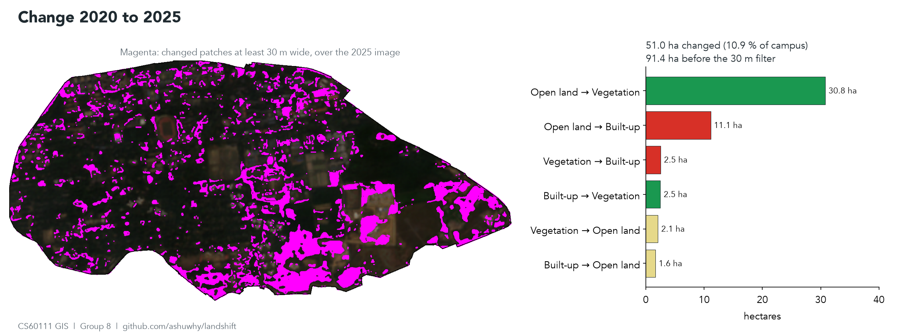
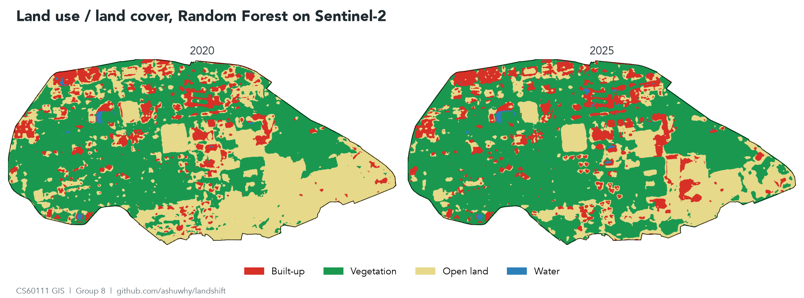
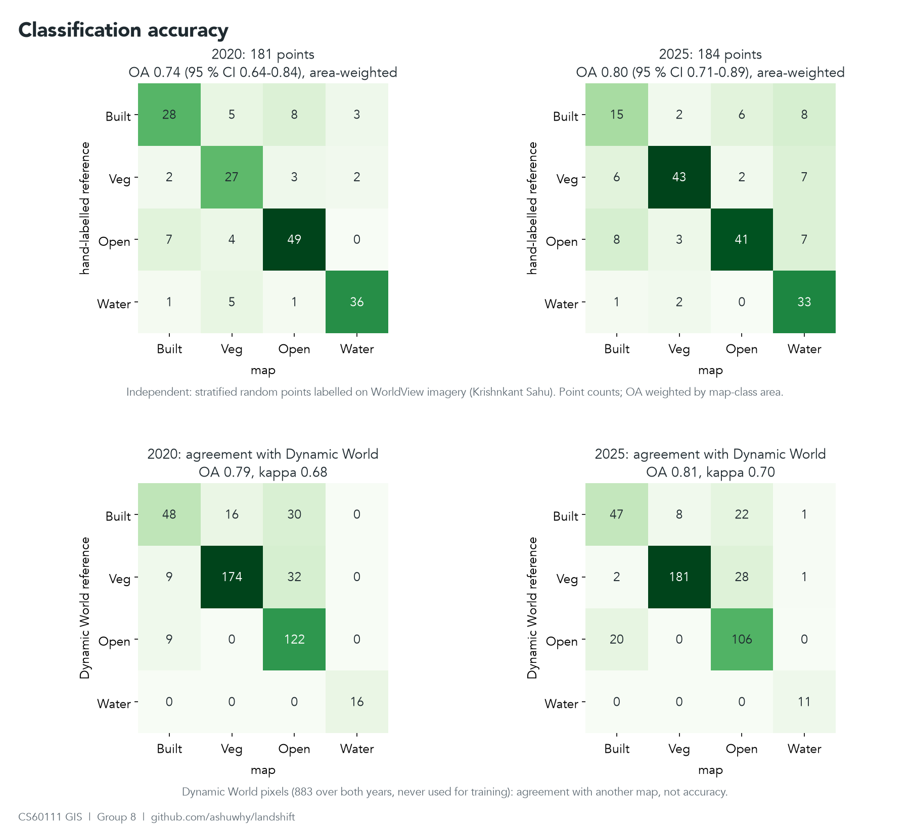

# LULC Mapping and Change Detection, IIT Kharagpur Campus (2020 vs 2025)

CS60111 Geographical Information System, Autumn 2026-27. Term project 3, Group 8.

Two-date land use / land cover map of the IIT Kharagpur campus from Sentinel-2,
and the change between them. Everything runs in Google Earth Engine: one script, with the hand-labelled training
points pasted above it.



Magenta: pixels whose class changed between 2020 and 2025 and that belong to a changed patch at least 30 m wide.
The large blocks in the south-east are the construction compound that does not exist in the 2020 image and the
grassland growing into scrub around it.

## Study area

Campus boundary is OpenStreetMap way [52435606](https://www.openstreetmap.org/way/52435606)
("Indian Institute of Technology Kharagpur"), 184 vertices, 469.2 ha.
It is embedded in the script and also kept as `data/iitkgp_campus_osm.geojson`.
The OSM polygon covers the main fenced campus. Halls and quarters outside that fence are not in it.

## Data

| Item | Value |
|---|---|
| Imagery | Sentinel-2 L2A, `COPERNICUS/S2_SR_HARMONIZED`, 10 bands (B2-B8A, B11, B12), tile 45QWE |
| Epoch 1 | 1 Nov 2019 to 29 Feb 2020 (winter), 11 scenes, plus 1 Mar to 31 May 2020 (pre-monsoon), 11 scenes |
| Epoch 2 | 1 Nov 2024 to 28 Feb 2025, 16 scenes, plus 1 Mar to 31 May 2025, 13 scenes. Same seasons, so phenology does not show up as change |
| Scene filter | tile cloud < 40 %, then cloud inside the campus < 10 % (winter) or < 20 % (pre-monsoon, hazier), from the SCL band |
| Training labels | 556 points labelled by eye on WorldView-2 (15 Mar 2020) and WorldView-3 (13 Jan 2024), `training/` |
| Comparison map | Dynamic World V1 (`GOOGLE/DYNAMICWORLD/V1`), modal label over the same window. Runs 1-3 trained on it |
| Projection for exports | UTM 45N, EPSG:32645, 10 m |


## Classes

| Code | Class | What goes in it | Dynamic World labels mapped here |
|---|---|---|---|
| 0 | Built-up | Roofs, roads, paved courts, parking | built |
| 1 | Vegetation | Tree canopy, dense scrub, flooded vegetation | trees, flooded vegetation |
| 2 | Open land | Lawns, playgrounds, dry grassland, bare soil, cleared plots | grass, crops, shrub and scrub, bare |
| 3 | Water | Ponds, tanks, open drains wide enough to fill a 10 m pixel | water |

Dynamic World almost never says "grass" on this campus (0.6 ha in 2020). It labels the lawns and
sports fields as crops, about 50 ha in 2020. There is no farmland inside the fence, so crops go to open land.
Putting them in vegetation would hide exactly the open-to-built conversions this project is looking for.
Dynamic World's "shrub and scrub" on campus is the dry grassland with scattered bushes in the east end, which the
independent points label open land, so it goes to open land too. Scrub dense enough to read as canopy is still vegetation.
Runs 1-3 trained on this remap. The final map trains on points labelled directly in the four classes; the remap is
now only used to compare with Dynamic World.

## Method

1. Median composites per epoch, winter and pre-monsoon, after masking cloud, cloud shadow, cirrus and saturated pixels (SCL 1, 3, 8, 9, 10).
2. Features: the 10 winter bands with NDVI, NDBI and NDWI; 3x3 standard deviation of NDVI and B8 (canopy is rough, lawns
   are smooth); B4, B8, B11, B12 and the three indices from the pre-monsoon composite, and the NDVI drop between
   the two (grass dries out by May, trees stay green). 23 features in all, added in run 3 to tell a lawn under
   scattered trees from canopy.
3. Training labels: 556 points I labelled by eye on WorldView (`training/NOTES.md`). 260 random locations inside
   the fence and 30 ponds within 3 km outside it (the campus ponds are already covered by validation points), each
   labelled on the 2020 and the 2024 image wherever its 10 m square held one class: 286 for 2020, 270 for 2025.
   Every training point is at least 30 m from every validation point. Before labelling I relabelled 24 validation
   points blind and matched 22. The training stack reaches 3.5 km past the fence so the ponds have pixel values;
   the maps stay clipped to the campus.
4. One Random Forest (500 trees, seed 42) trained on the points of both epochs together and applied
   to both composites. Two separately trained forests disagree on the same unchanged pixel, and that disagreement
   shows up as fake change. A first run done that way reported 91 ha of built-up turning into vegetation.
5. Dynamic World, now only for comparison: every scene is mapped to the four classes, the mode is taken, and a
   pixel is kept where at least 60 % of the scenes agree with it. A stratified sample per epoch (300 built-up,
   700 vegetation, 450 open land, 40 water) trained runs 1-3 on its 70 % split; the other 30 %, 883 pixels, gives
   the agreement figure. With equal counts per class those runs put 224 ha in built-up, when Dynamic World itself
   says about 110.
6. 3x3 majority filter on both class maps.
7. Accuracy, two ways:
   - Agreement with Dynamic World on the 883 held-out pixels. That measures closeness to another map, not accuracy.
   - Independent points (`gee/validation_points.js`): 181 for 2020 and 184 for 2025, at least 25 per class per year.
     A stratified random sample on the map classes, labelled on WorldView-2 imagery of 15 Mar 2020 and WorldView-3
     imagery of 13 Jan 2024 (Esri World Imagery Wayback). These are the numbers to quote in the report.
     Imagery, labelling rules and hard cases are in `validation/NOTES.md`.
   - Every change to the method after the first independent check (OA 0.61 / 0.74) was chosen on the odd-numbered
     points only, with the even-numbered half held out (see "How the method was chosen").
8. Post-classification change: `code = 10 * class2020 + class2025`, so `12` is vegetation to open land.
   A changed pixel only counts if it survives a one-pixel erosion of the change mask (then dilated back),
   so changed strips narrower than about 30 m are dropped. Without this every roof gets a ring of change
   from the one-pixel boundary shift between the two composites.

## Results

All numbers come from `results/results.json`, written by `scripts/run_pipeline.py`.



### Area by class (ha)

| Class | 2020 | 2025 | Map difference |
|---|---|---|---|
| Built-up | 70.3 | 78.8 | +8.5 |
| Vegetation | 240.6 | 286.2 | +45.7 |
| Open land | 156.0 | 101.4 | -54.7 |
| Water | 1.0 | 1.6 | +0.5 |

These are map areas. Their difference is not the net change: it also counts the one-pixel ring around roofs that
the 30 m change filter drops. Net change from the from-to table below is built-up +9.4 (13.7 gained, 4.4 lost),
vegetation +28.7 and open land -38.2 ha. The independent points give area estimates that correct for the map's errors (next section);
quote those for class totals. The classes add up to 468.0 ha against the 469.2 ha polygon; the rest is boundary pixels whose centre falls outside it.

### Change, 2020 to 2025 (ha)

51.0 ha changed (10.9 % of the campus); 91.4 ha before the 30 m filter.

| From | To | ha | What it is on the ground |
|---|---|---|---|
| Open land | Vegetation | 30.8 | Grassland growing into scrub, 23.5 ha of it south-east of the campus centre. Median winter NDVI 0.40 to 0.53, pre-monsoon 0.47 to 0.62, while pixels that stay open land move 0.37 to 0.40 and 0.42 to 0.46, so a wetter year would explain about a quarter of it |
| Open land | Built-up | 11.1 | Mostly the south-east construction compound (6.2 ha), scrub and tracks in 2020; NDVI 0.33 to 0.17 |
| Vegetation | Built-up | 2.5 | New buildings on wooded plots; NDVI 0.52 to 0.24 |
| Built-up | Vegetation | 2.5 | Canopy closing over roofs (NDVI 0.31 to 0.43). Read as greening, not demolition |
| Vegetation | Open land | 2.1 | Clearing; NDVI 0.54 to 0.33 |
| Built-up | Open land | 1.6 | |
| Built-up and water, both ways | | 0.3 | |

On Dynamic World labels (run 3) built-up and vegetation swapped 17.7 ha, mostly canopy over unchanged roofs that
one map called built-up and the other vegetation. With the WorldView labels that swap is 5.0 ha.

The independent points point the same way: estimated open land falls from 146 to 96 ha and vegetation rises from
220 to 315 ha (table below). The two samples are separate points, so that is a check on direction, not a change accuracy.

### Accuracy

Against the independent points (181 for 2020, 184 for 2025, `validation/`), on the filtered maps the areas come from.
The sample is stratified by the classes of the first map, so every estimate is weighted by the area of those strata
(Olofsson et al. 2014; Stehman 2014, since the current map no longer matches the strata; `validation/strata_ha.json`).
Raw point counts would let water, 0.2 % of the campus and a third of the points, set the score.

| | 2020 | 2025 |
|---|---|---|
| Overall accuracy (95 % CI) | 0.74 (0.64-0.84) | 0.80 (0.71-0.89) |
| User's accuracy (built / veg / open / water) | 0.62 / 0.75 / 0.79 / 0.88 | 0.44 / 0.91 / 0.76 / 0.60 |
| Producer's accuracy (built / veg / open / water) | 0.47 / 0.92 / 0.65 / 0.17 | 0.65 / 0.89 / 0.57 / 0.92 |

Run 3, on Dynamic World labels, scored 0.67 (0.57-0.78) and 0.77 (0.67-0.87).

Estimated area from the points (95 % CI), ha:

| Class | 2020 | 2025 |
|---|---|---|
| Built-up | 99 (60-137) | 57 (33-82) |
| Vegetation | 220 (169-272) | 315 (273-356) |
| Open land | 146 (98-194) | 96 (56-135) |
| Water | 3 (0-8) | 0.4 (0-1) |



Built-up is now the weak class. Producer's accuracy is 0.47 in 2020: of 44 built-up reference points, 5 are mapped
vegetation (roofs under canopy) and 8 open land (paved courts). User's accuracy is 0.44 in 2025, where built-up
spreads onto bare plots and dry courts with the SWIR signal of roofs. Open land, the weak class while Dynamic World
supplied the labels (producer's 0.41 / 0.33), is now 0.65 / 0.57; open land mapped as built-up fell from 13 to 7
points in 2020 and from 21 to 8 in 2025.

False water got worse. In 2025, 22 of the 55 points mapped water are not water (run 3 had 1): shade north of the
new tall blocks, dark roofs, canopy on pond banks. Every water training point is an open pond and no shaded ground
was labelled, which is the likely cause. All 22 sit in the 0.9 ha water stratum, so they pull water's user's accuracy
to 0.60 but barely move any area. Producer's accuracy for water rests on a few points in large strata and means little.
The built-up estimate for 2025 (57 ha) below 2020 (99 ha) is not demolition: the two point samples are independent,
the intervals overlap, and 2025 built-up has only 31 points.

Agreement with Dynamic World on its 883 held-out pixels is 0.79 / 0.81 (kappa 0.68 / 0.70), down from 0.82 / 0.88
when Dynamic World was the label source. Agreement with another map is not accuracy, and part of the old agreement
was shared error.
The Code Editor prints the unweighted matrices on the unfiltered classification (OA 0.79 / 0.73, kappa 0.72 / 0.64);
`scripts/run_pipeline.py` writes both to `results.json`.
Random Forest importance is flat, the top ten within 10 % of each other: 3x3 texture of NDVI and B8 lead, then B11,
pre-monsoon NDVI, B8 and pre-monsoon B11. Out-of-bag error is 0.19 on the 556 training points.

### How the method was chosen

Runs 1-3 trained on Dynamic World labels. The first version (winter composite only, open land sampled at its share, shrub as vegetation) scored 0.61 / 0.74.
Dynamic World itself scores 0.58 / 0.73 against the points, so the forest was copying its labels' mistakes:
at the reference open-land points DW says trees or built about half the time. Ten variants were scored on the
odd-numbered points (`scripts/compare_variants.py`), mean OA over both years. The first six were picked from the error notes, the last four
check which parts of the chosen one matter:

| Variant | Odd points | Even points (held out) |
|---|---|---|
| First version | 0.65 | 0.70 |
| + open land sampled at 450 | 0.645 | 0.755 |
| + texture | 0.635 | 0.755 |
| + pre-monsoon composite | 0.665 | 0.715 |
| all three | 0.67 | 0.755 |
| **all three + shrub to open land (run 3)** | **0.685** | **0.76** |
| shrub to open land only | 0.66 | 0.74 |
| open land at 450 + shrub | 0.665 | 0.775 |
| open land at 450 + pre-monsoon + shrub | 0.68 | 0.76 |
| run 3, with open land at 600 | 0.675 | 0.795 |
| run 3 + GLCM on B8, 3×3 | 0.665 | 0.78 |
| run 3 + GLCM on B8, 5×5 | 0.645 | 0.765 |
| run 3 + GLCM on B8 and NDVI, 3×3 | 0.67 | 0.77 |

Chosen on the odd half by a rule fixed before the runs (best mean OA there); two variants do a little better on the even half, which is the noise below. Differences under about 0.05 are within the noise of
90 points, so the honest claim is "better on both halves", not the third decimal.

The three GLCM rows were tried after the choice, to see if grey-level texture (contrast, entropy, homogeneity,
correlation on 8-bit NIR or NDVI) separates roofs from canopy. It does not: all three score below run 3
on the odd half, and built-up producer's accuracy on the 2020 odd points falls from 0.57 to 0.47.
At 10 m a roof under trees is one or two mixed pixels, too few for a co-occurrence window to see. Not adopted.

The harness draws run 3's training split slightly differently from `run_pipeline.py` (2103 vs 2095 training points),
so its numbers compare variants with each other; the reported accuracies come from the pipeline itself.

### Run 4: better labels or more data

After run 3 the remaining errors pointed at the labels: at the reference open-land points Dynamic World says trees or
built about half the time, and every run so far had learned from it. Two ways out: give the forest more data on the
same labels, or replace the labels. Both were scored on the same halves, paired against run 3 rerun the same day
(`scripts/compare_variants.py --score E5`, all 43 variants in `results/variant_scores.json`). Mean OA of both years:

| Variant | Odd points | Even points (held out) |
|---|---|---|
| Run 3: Dynamic World labels, 100 trees | 0.684 | 0.758 |
| + Sentinel-1 radar | 0.672 | 0.757 |
| + AlphaEarth embeddings | 0.645 | 0.761 |
| + Open Buildings 2.5D | 0.665 | 0.768 |
| + GLCM texture on B8, 3×3 | 0.667 | 0.776 |
| 500 trees | 0.668 | 0.769 |
| only pixels where ESRI land cover agrees | 0.622 | 0.719 |
| **WorldView labels, same 23 features, 500 trees (run 4, used)** | **0.725** | **0.808** |
| WorldView labels, 100 trees | 0.752 | 0.801 |
| WorldView labels + Sentinel-1 | 0.724 | 0.812 |
| WorldView labels + GLCM | 0.724 | 0.819 |
| WorldView labels + AlphaEarth | 0.703 | 0.812 |

None of the extra data helps on Dynamic World labels: every row sits at or below run 3 on the odd half. A forest
told that a lawn is crops or trees only learns that mistake in more detail. The new labels move both halves, and the
extra sources add nothing on top of them either.

The rule fixed before these runs was: adopt a variant only if it beats run 3's 0.685 on the odd half by more than
0.05 and holds on the even half. Run 4 as shipped falls short of that. Against run 3 as shipped it gains +0.041 on the
odd half (paired 95 % CI -0.026 to 0.119) and +0.050 on the even half (-0.013 to 0.115). I adopted it anyway, for two
reasons:

- Seed 42 happened to be run 3's best forest of six on the odd half. Like for like, both at 500 trees, the odd-half
  gain is +0.057; on the mean of seven forests it is +0.052.
- Seven forests per label source (six seeds, one 500-tree forest): every forest on the WorldView labels beats every
  forest on Dynamic World's, on both halves. Odd half 0.701-0.752 against 0.663-0.684; even half 0.796-0.832 against
  0.758-0.784.

The seeds rule out forest luck, not point luck. Each paired interval still includes zero, because 365 test points
are few. The shipped forest has 500 trees rather than 100 because at 100 trees seed 42 was again the best of six on
the odd half (0.752); 500 trees lands on the seed mean (0.725), the number to trust.

### Dating the south-east compound

`scripts/date_compound.py` imports the shipped forest from `run_pipeline.py` and classifies one winter composite
(with its pre-monsoon pair) for every year from 2020 to 2025. The site is the largest cluster of the open land to
built-up change: 6.2 of the campus's 11.1 ha, inside a 16 ha outline. Share of those pixels mapped built-up:

| Winter | 2019-20 | 2020-21 | 2021-22 | 2022-23 | 2023-24 | 2024-25 |
|---|---|---|---|---|---|---|
| Built-up | 0 % | 2 % | 34 % | 61 % | 56 % | 100 % |

The crops (`results/compound_<year>.png`) show a bare patch by early 2020, the whole site bare in 2020-21, roof
shapes in 2022-23 and a second block to the south-west by 2024-25. The 34 % in 2021-22 is mostly bare soil, which
has the same SWIR signal as roofs; the dip in 2023-24 is year-to-year noise. The two ends are 0 % and 100 % by
construction, since the site is defined by the 2020 and 2025 maps.

## Running it

Earth Engine Code Editor:

1. Open <https://code.earthengine.google.com> (needs a registered noncommercial Cloud project).
2. Paste `gee/training_points.js`, then `gee/lulc_pipeline.js` below it in the same script, and press **Run**.
   No drawing needed. Without the training points the forest has nothing to train on.
3. Console: scene tables, sample counts, confusion matrices, OA, kappa, PA, UA, areas, transitions.
4. Tasks tab: run the exports. Everything goes to `Drive/GEE_LULC/`.


Class maps with the change layer (magenta) on top, after a run.

Python, same pipeline, writes `results/`:

```bash
pip install -r scripts/requirements.txt
earthengine authenticate
python scripts/export_training.py      # training/points.csv -> gee/training_points.js
python scripts/run_pipeline.py <your-cloud-project>
python scripts/date_compound.py <your-cloud-project>
python scripts/make_figures.py . docs/img
```

Independent validation: paste `gee/validation_points.js` above the pipeline too.
It defines the point layers `built20, veg20, open20, water20, built25, veg25, open25, water25`; the script
picks them up and prints the independent confusion matrices. See `validation/NOTES.md`.

## Outputs

| File | Content |
|---|---|
| `results/results.json` | Scene lists, sample counts, confusion matrices, OA, kappa, PA, UA, importance, areas, from-to table |
| `results/*.png` | True colour composites, class maps, change map |
| `results/compound_dating.json`, `results/compound_*.png` | Yearly classes and true-colour crops of the south-east compound |
| `results/variant_scores.json`, `results/variants/` | Every method variant scored on both validation halves, with paired CIs against run 3 |
| `docs/img/` | Figures with titles and legends built from `results/` (README, slides), Code Editor screenshots |
| `S2_composite_2020.tif`, `S2_composite_2025.tif` | 10-band reflectance composites (Drive export) |
| `LULC_2020.tif`, `LULC_2025.tif` | Class maps, values 0-3 (Drive export) |
| `LULC_transition_code.tif` | From-to code per pixel (Drive export) |
| `area_2020.csv`, `area_2025.csv`, `transitions_2020_2025.csv` | Hectares per class and per from-to pair (Drive export) |

## Known limits

- Built-up is the weak class (producer's 0.47 in 2020, user's 0.44 in 2025): roofs under canopy, paved courts.
  Transitions of a few hectares are within error; the results rest on the large, NDVI-checked ones.
- Change accuracy is not measured. Two maps at 0.74 and 0.80 give a change map below either.
- The gain from the WorldView labels is not yet significant: +0.05 / +0.04 OA over run 3, each paired 95 % interval
  includes zero. Two to three times the test points would settle it, if the gain holds.
- Shade north of the new tall blocks is mapped as water in 2025 (22 points, against 1 in run 3). No shaded ground is
  in the training set; labelling some would be the fix.
- I labelled the training points and Krishnkant the test points, under the same rules (`validation/NOTES.md`), so a
  bias in the rules themselves would be in both. The blind relabel (22 of 24) checks the labellers, not the rules.
- The method was chosen on half of the validation points. The held-out half scores 0.77 / 0.84 and the half it was
  chosen on 0.69 / 0.76, so the choice did not fit that half's noise.
- 10 m pixels mix roof and canopy along tree-lined roads and in the residential quarters. Most of the built-up / vegetation confusion is there.
- The 30 m filter also drops real change narrower than 30 m, for example a single new building on a lawn.
- Per-map class areas and the from-to table do not reconcile exactly, because the class areas still include the sub-30 m edge flips that the change filter drops.
- Dry-season haze is not masked by SCL. The 10 % in-campus cloud filter helps, but it is not a haze filter.

## Repository layout

```
gee/lulc_pipeline.js      the pipeline (Code Editor)
gee/original/             my first drafts of the acquisition and classification scripts, kept for history
gee/validation_points.js  independent validation points as the Code Editor layers built20 ... water25
gee/training_points.js    the training points as training20, training25 (paste above the pipeline)
scripts/run_pipeline.py   same pipeline through the Python API, writes results/
scripts/make_figures.py   titled figures from results/ into docs/img/
scripts/compare_variants.py  the method variants scored on the validation halves
scripts/date_compound.py  one map per winter 2020-2025 over the south-east compound
scripts/sample_validation_points.py  draws the validation sample from results/
scripts/export_validation.py         validation/points.csv -> gee/validation_points.js and the location figure
scripts/sample_training_points.py    draws the training locations, 30 m clear of every validation point
scripts/training_sheets.py           WorldView labelling sheets for the training locations
scripts/export_training.py           training/points.csv -> gee/training_points.js
training/                 the training points with labels (points.csv), locations, labelling notes (NOTES.md)
validation/strata_ha.json the stratum areas the validation sample was drawn from
validation/               the validation points with labels and notes (points.csv), labelling notes (NOTES.md)
results/                  numbers and figures from the last run
docs/img/                 figures and screenshots used in this README
data/                     campus boundary from OSM
TASKS.md                  who does what before the mid-term
```

## Team and contributions

| Member | Roll no. | Contribution so far |
|---|---|---|
| Ashutosh Sharma | 23CS10005 | Earth Engine pipeline, from my first drafts (`gee/original/`) to `gee/lulc_pipeline.js`: cloud-masked Sentinel-2 composites, Dynamic World training labels, Random Forest, post-classification change. Diagnosed the first run (224 ha built-up, 139 ha of change) and fixed it: proportional sampling, one forest for both years, crops to open land, 30 m change filter. Python runner that reproduces every Console number. Both epochs run: class maps, areas, from-to table, accuracy. Change checked against NDVI. Area-weighted independent accuracy and area estimates from the validation points (Olofsson / Stehman estimators). Found that the map copied Dynamic World's open-land errors and fixed it (pre-monsoon composite, texture, label and sampling changes), chosen on half the points and checked on the other half: OA 0.61 / 0.74 to 0.67 / 0.77. Run 4: drew 290 training locations clear of the test points, labelled 556 training points on WorldView myself (`training/`), and tested them against Sentinel-1, AlphaEarth embeddings, Open Buildings heights and GLCM texture, with a seven-forest seed check: OA 0.67 / 0.77 to 0.74 / 0.80. Yearly composites dating the south-east compound. Figures, this README, the mid-term deck |
| Krishnkant Sahu | 23CS10035 | Independent validation set: 365 points (181 for 2020, 184 for 2025, at least 25 per class per year), a stratified random sample on the map classes labelled on dated high-resolution imagery (WorldView-2, 15 Mar 2020; WorldView-3, 13 Jan 2024) after correcting its offset to Sentinel-2 (`gee/validation_points.js`, `validation/points.csv`). Labelling notes: imagery dates, rules, hard cases (south-east compound, shadows of the new buildings, algae-covered ponds, dark roofs) and a first look at the map errors (`validation/NOTES.md`). Sampling and export scripts, location figure |
| Sanskar Sovitkar | 24CS10131 | |
